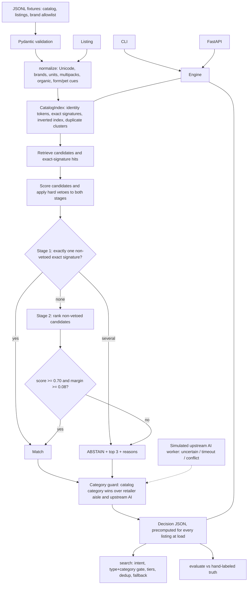

# prox-grocery-identity-engine

An offline, explainable engine that maps synthetic retailer grocery listings to canonical product IDs, or **abstains** when the evidence is weak or conflicting. It also keeps the approved catalog category safe from noisy retailers and an uncertain upstream AI worker. Its ranked `/search` excludes broth and dog food from "chicken breast" results in the bundled fixtures and regression tests.

Prox Software Engineering Intern assessment, **Track C: Search, Product Matching & Applied AI**. All data is synthetic. The engine makes no external network calls and needs no paid APIs, LLMs or secrets. Installing dependencies may require network access.

## Quick start

Requires Python 3.12+ and [uv](https://docs.astral.sh/uv/).

```bash
uv sync --locked
uv run prox-match demo      # one-command offline walkthrough
uv run pytest -q            # 142 tests
```

Other commands:

```bash
uv run prox-match match --listing-id T008            # one decision as JSON
uv run prox-match match --file my_listings.jsonl     # any listings file
uv run prox-match search -q "chicken breast" --retailer FreshTown
uv run prox-match evaluate                           # metrics + confusion report
uv run prox-match benchmark --searches 100           # index build + p50/p95
uv run prox-match fixtures --check                   # regenerate-and-compare fixtures
uv run uvicorn prox_match.api:app --port 8000        # HTTP API, docs at http://127.0.0.1:8000/docs
```

The `match`, `search`, `evaluate`, `benchmark` and `demo` subcommands take `--catalog`, `--listings` and `--aliases`. Custom files must follow the documented record formats; the demo also requires its bundled T-series listing IDs. `fixtures` uses the bundled fixture paths, and the uvicorn command starts the API with the default data. Without uv: `python -m venv .venv`, activate it, `pip install -e . pytest httpx`, then run the same commands without `uv run`.

## Architecture



| Module | Job |
|---|---|
| `models.py` | Pydantic input records and the JSONL loader (line-numbered errors) |
| `normalize.py` | Text cleanup, brand allowlist, size parser (oz/lb/g/kg, fl oz/gal/L/ml, ct/dozen, `2 x 8 oz`, `1/2 gal`), organic, unit price |
| `index.py` | Identity features, exact signatures, inverted token index, duplicate clusters (C107/C108) |
| `matcher.py` | Two-stage match, vetoes, threshold + margin, ABSTAIN with top 3 |
| `category.py` | Category guard and the fake upstream worker with a real timeout |
| `search.py` | Ranked, deduplicated, retailer-filtered search with fallback |
| `evaluate.py`, `bench.py` | Metrics vs truth; measured latency |
| `engine.py`, `api.py`, `cli.py` | One shared engine; thin HTTP and CLI adapters |

## Data

| File | Written by | Count |
|---|---|---|
| `fixtures/canonical_catalog.jsonl` | hand; C101–C112 verbatim from the assessment | 46 IDs |
| `fixtures/retailer_listings.jsonl` | 38 hand-written tricky + 62 generated (seed 42) | 100 listings, 3 retailers |
| `fixtures/ground_truth.jsonl` | hand, reviewed by me, committed **before** any matcher code (`874e0f9`) | 38 labels (28 dev, 10 held-out) |
| `fixtures/brand_aliases.json` | hand | 9 approved brands + look-alike traps that are *not* listed |

Generation rules and record formats: [fixtures/README.md](fixtures/README.md).

## How matching decides

1. **Normalize.** NFKD + accent stripping + casefold; brands only through an explicit allowlist (`Farm House` → Farmhouse, `Ocean Cache` → unknown); sizes to a base unit per dimension (mass oz, volume fl oz, count ct) with pack count kept; no organic word means non-organic (a decided policy, with lower confidence).
2. **Stage 1, exact signature:** brand, organic, dimension, total size, pack count and identity words. Exactly one non-vetoed hit → match. Several non-vetoed hits → `CATALOG_DUPLICATE` and ABSTAIN. Hard vetoes apply to exact hits too.
3. **Stage 2, retrieve and rerank.** Candidates come from the inverted index. Score = (0.75 × share of catalog words found + 0.25 × share of listing words explained) × brand factor × organic factor.
4. **Hard vetoes** can't be outscored: approved brand ≠ catalog brand, unknown brand vs a branded item, a different product type ("oat milk" hides "milk"), form cues (canned / fresh / frozen / broth / steak), pet vs human food, organic conflict, size mismatch (1% tolerance), mass vs volume, multipack vs single.
5. **Accept a reranked match** only if the best non-vetoed score is ≥ 0.70 and beats the runner-up by ≥ 0.08. A unique non-vetoed exact signature is accepted by Stage 1 instead. Ties in reranking never get broken by ID. A missing, zero or unreadable size always abstains.
6. **Auto-approve** only at ≥ 0.90. Lower matches keep their ID but set `reviewer_flag`.

`confidence` is a heuristic ranking score, **not a calibrated probability**.

### Category guard

The catalog category of a matched ID wins by default. The simulated upstream AI worker can return `CATEGORY_UNCERTAIN`, time out (a real 0.2 s deadline) or crash, and the category doesn't change (`APPROVED_CATEGORY_PRESERVED`). A confident disagreement sets `reviewer_flag`. For a matched ID, only an explicit `conflict_review=True` call, the human-review path, applies the upstream category. Abstained listings get the category their plausible candidates agree on, otherwise a confident upstream suggestion if provided, otherwise `UNKNOWN`; they remain flagged for review.

## Sample output (real runs)

**Corrected category.** Broth the retailer filed under "Meat & Poultry" (`prox-match match --listing-id T008`, trimmed):

```json
{
  "listing_id": "T008",
  "canonical_id": "C104",
  "canonical_name": "Heritage Chicken Broth, 32 fl oz",
  "assigned_category": "PANTRY",
  "normalized_size": {"total_value": 32.0, "unit": "fl oz", "dimension": "volume", "pack_count": 1, "unit_value": 32.0},
  "match_stage": "exact_signature",
  "confidence": 0.95,
  "reason_codes": ["EXACT_SIGNATURE", "ORGANIC_INFERRED", "RETAILER_CATEGORY_OVERRIDDEN"],
  "reviewer_flag": false,
  "top_candidates": [
    {"canonical_id": "C104", "score": 0.95, "vetoes": []},
    {"canonical_id": "C126", "canonical_name": "Heritage Low Sodium Chicken Broth, 32 fl oz", "score": 0.5938, "vetoes": []},
    {"canonical_id": "C125", "canonical_name": "Heritage Vegetable Broth, 32 fl oz", "score": 0.475, "vetoes": ["TYPE_MISMATCH"]}
  ]
}
```

**ABSTAIN.** Whole milk fits the duplicate IDs C107 and C108 equally (`--listing-id T014`, trimmed):

```json
{
  "listing_id": "T014",
  "canonical_id": null,
  "canonical_name": null,
  "assigned_category": "DAIRY",
  "match_stage": "abstain",
  "confidence": 0.0,
  "reason_codes": ["CATALOG_DUPLICATE", "ORGANIC_INFERRED", "CATEGORY_FROM_CANDIDATES"],
  "reviewer_flag": true,
  "top_candidates": [
    {"canonical_id": "C107", "canonical_name": "Whole Milk, 1 gal", "score": 0.95, "vetoes": []},
    {"canonical_id": "C108", "canonical_name": "Whole Milk, 128 fl oz", "score": 0.95, "vetoes": []},
    {"canonical_id": "C115", "canonical_name": "2% Reduced Fat Milk, 1 gal", "score": 0.2969, "vetoes": []}
  ],
  "unit_price": {"cents_per_unit": 3.3516, "unit": "fl oz"}
}
```

**Search.** `GET /search?q=chicken%20breast&retailer=FreshTown`. Broth is PANTRY, dog food is PET and the seasoning rub is UNKNOWN, so the type and category gate keeps all three out:

```json
{"intent": {"canonical_ids": ["C103", "C122"], "categories": ["FROZEN", "MEAT"], "types": ["chicken"]},
 "fallback": false, "reason": null,
 "results": [
  {"listing_id": "T006", "raw_name": "Farmhouse Boneless Skinless Chicken Breast", "canonical_id": "C103", "score": 1.8781,
   "components": {"tier": 1, "query_coverage": 1.0, "listing_coverage": 0.6667, "match_confidence": 0.8906}},
  {"listing_id": "G029", "raw_name": "Golden Crisp Breaded Chicken Breast Nuggets", "canonical_id": "C122", "score": 1.84,
   "components": {"tier": 1, "query_coverage": 1.0, "listing_coverage": 0.5, "match_confidence": 0.95}}]}
```

Full runs: [outputs/demo_output.json](outputs/demo_output.json), [outputs/evaluation_report.json](outputs/evaluation_report.json), [outputs/benchmark_report.json](outputs/benchmark_report.json).

## Results

From the saved `prox-match evaluate` report. The matching policy was committed (`899700d`) before the first held-out evaluation. That result was used as the final policy check; later reproducibility checks did not drive policy tuning.

| Split | n | TP | TN | FP | FN | Precision | Recall | Exact-ID acc. | Abstention | High-conf FP | Category error |
|---|---|---|---|---|---|---|---|---|---|---|---|
| dev | 28 | 21 | 7 | 0 | 0 | 1.00 | 1.00 | 1.00 | 0.25 | 0.00 (0/16) | 0.037 (T004) |
| held-out | 10 | 4 | 6 | 0 | 0 | 1.00 | 1.00 | 1.00 | 0.60 | 0.00 (0/3) | 0.00 |

A wrong-ID prediction counts as both an FP and an FN. Zero denominators report `null`, not 100%.

**Read these numbers with care.** The same AI-assisted workflow produced both the labels and the rules; I reviewed the labels and approved the policy. These 38 cases are far too few for statistical claims. A perfect score shows the rules are internally consistent on their intended traps, not production accuracy. The one miss: T004 ("Ocean Cache" false brand) correctly abstains, but its candidates disagree on category, so it gets `UNKNOWN` instead of PANTRY.

Across all 100 listings, 16 abstain and 22 carry `reviewer_flag`. Of the 62 clean generated listings, 3 abstain, all of them whole milk hitting the C107/C108 duplicate.

**Benchmark** (`prox-match benchmark`, Windows 11 laptop, AMD64 with 12 logical CPUs, Python 3.12.14): engine build (load, index, match all 100 listings, search index) **39 ms**; **100 searches p50 0.26 ms, p95 0.39 ms** after 10 warm-ups (three runs within 0.01 ms; before the [#3](https://github.com/NgoBenny/prox-grocery-identity-engine/issues/3) search pre-filter it was p50 0.43, p95 0.68); single-listing match p50 0.26 ms. Percentiles are nearest-rank. **Cache policy:** no result cache; the index is built at startup and treated as read-only, and decisions are computed once at load, so search never re-runs the matcher. Timings vary run to run; these are small-corpus measurements.

## Human review: what goes there, what never auto-approves

**Sent to review** (`reviewer_flag: true`): every ABSTAIN, with its top 3 candidates and veto reasons; any match below 0.90; any match where the upstream AI confidently disagrees with the catalog category; any catalog duplicate cluster (C107/C108 should be merged once in review, not decided per listing).

**Blocked from auto-approval when the normalized evidence establishes the conflict below.** These checks depend on the recognized words and units; they do not guarantee detection of every possible phrasing.

**Never auto-approved under those checks:**
- a match across a form, type or pet-vs-human boundary (canned ↔ fresh, broth ↔ meat, dog food ↔ chicken)
- an explicit organic conflict
- weight vs fluid volume, a size mismatch, or a missing or zero size
- a multipack mapped to a single-pack ID
- an unknown or look-alike brand matched to a branded item
- a tie or a margin under 0.08
- any category change suggested by an AI worker without explicit conflict review
- any LLM self-reported confidence, used as truth

## Feature checklist

- [x] Python library + HTTP endpoint + CLI over one engine; fully offline, no LLM
- [x] Required record shapes and output fields; ≥ 40 IDs (46), ≥ 80 listings (100), 3 retailers, ≥ 25 tricky hand labels (38)
- [x] C101–C112 verbatim (tested); deterministic fixture generation with a hash check
- [x] Normalization: Unicode, punctuation, brand aliases, gal/fl oz, lb/oz, kg/g, multipacks, per-unit price, no volume-to-weight comparison
- [x] Two-stage match, hard vetoes, ABSTAIN with top 3 and explanations
- [x] Category guard vs simulated `CATEGORY_UNCERTAIN`, timeout, and confident conflict; corrected-category examples (T008, T010)
- [x] `/search` with retailer filter, dedup by (retailer, canonical_id), typo and related fallback, `no_safe_match`, exposed score components
- [x] Precision, recall, exact-ID accuracy, abstention, high-confidence FP rate, category error rate, confusion report
- [x] ≥ 20 regression assertions: 28 parametrized adversarial cases plus 114 other tests (142 total)
- [x] Indexing + 100-search benchmark with measured p50/p95
- [x] SCALE_AND_COST.md, AI_USAGE.md, DEMO.md
- [ ] LLM secondary resolver: deliberately not built; the upstream-worker interface shows where one plugs in
- [ ] CI workflow: not built

## Assumptions

- No organic word in a listing means non-organic. Retailers almost always advertise organic.
- C107 and C108 are the same product under two IDs. Listings that match them abstain, and the fix is a catalog merge.
- A twin pack (`2 x 8 oz`) is a different item from a single 16 oz package, even at the same total weight.
- Sizes within 1% are equal (covers 454 g ≈ 1 lb and 1 kg ≈ 35.274 oz, and keeps 14.5 oz apart from 14.75 oz).
- The retailer aisle is noise for category (never trusted over the catalog) but counts as evidence that a product is pet food.

## Known limitations

- The truth set is small and came from the same AI-assisted workflow as the rules (labels reviewed by me). Prox's unpublished cases are the real test.
- Form cues, pet words, aisle words and size descriptors are hand-written English word lists. Unrecognized synonyms (for example, "pup" as pet evidence) may need list updates.
- Product type phrases come from the catalog's `type` field. When no phrase is detected, matching falls back to lexical evidence and the remaining vetoes; abstention is not guaranteed. "Chicken Jerky Treats" without pet evidence abstains in the bundled catalog.
- Generic unbranded listings of branded products ("Chicken Breast 1 lb", no brand) usually abstain, because of the missing-brand penalty.
- `confidence` is not calibrated, and the 0.70 / 0.08 / 0.90 thresholds were set on 28 dev cases.
- The low-score review findings first filed as issues (#1, #2, #3, #5) were fixed afterwards, each with a regression test that fails on the old code.
- `CatalogIndex.candidates` still scans the whole vocabulary for fuzzy token matches (a marked `shortcut:`). It's fine at this corpus size and is the first thing to replace at scale.

## Next three priorities

1. **An independently labeled evaluation set** of a few hundred listings from a second person, then calibrate `confidence` against it (isotonic or binned), so thresholds come from measured precision rather than judgment.
2. **Scale retrieval.** Replace the linear fuzzy vocabulary scan in `CatalogIndex.candidates` with a trigram or RapidFuzz `process.extract` index, shard postings by category, and match incrementally by listing content hash (see [SCALE_AND_COST.md](SCALE_AND_COST.md)).
3. **Learn the word lists from review outcomes.** Every reviewer decision on an ABSTAIN becomes a candidate alias, form cue or type synonym, approved into versioned lists, plus a catalog-merge workflow for duplicate clusters like C107/C108.

## Time and AI use

Active hours by step and category: [TIME_LOG.md](TIME_LOG.md), 2.35 h through Step 3, docs to be added. Tools, prompts, corrections and review-gate logs: [AI_USAGE.md](AI_USAGE.md). Demo script: [DEMO.md](DEMO.md). Demo video: _link to be added_.
